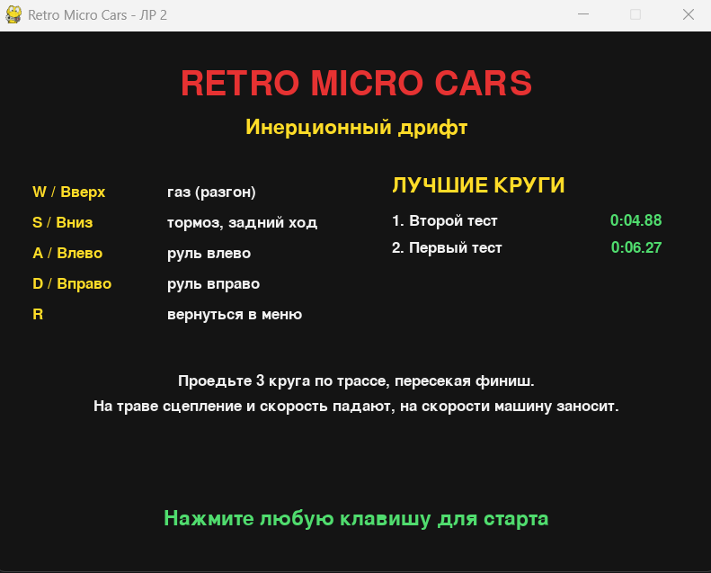
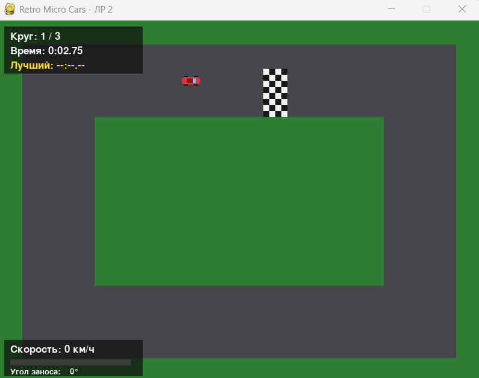
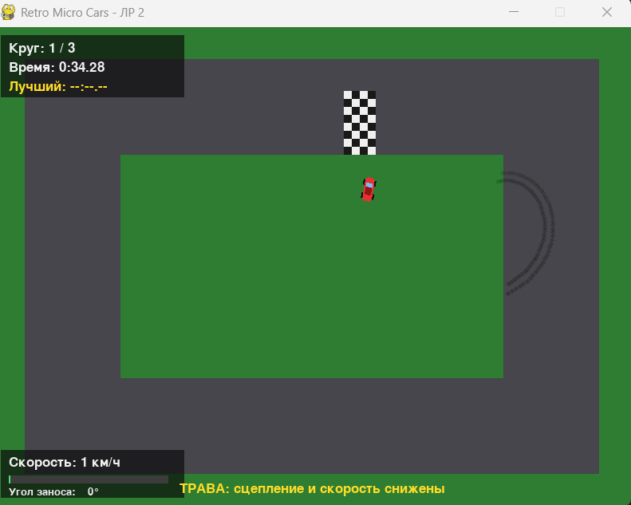
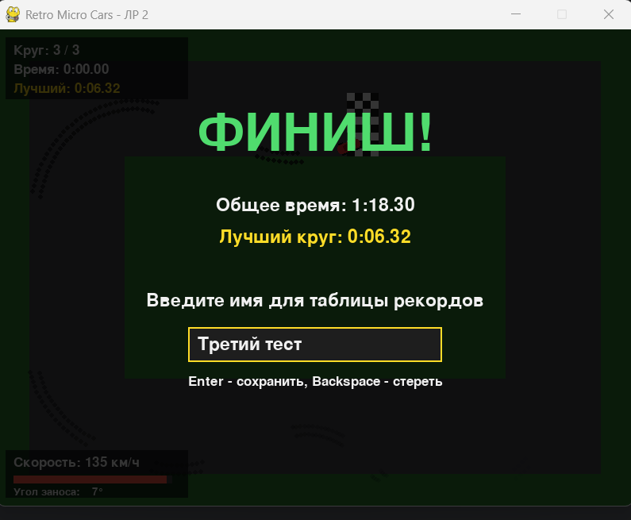
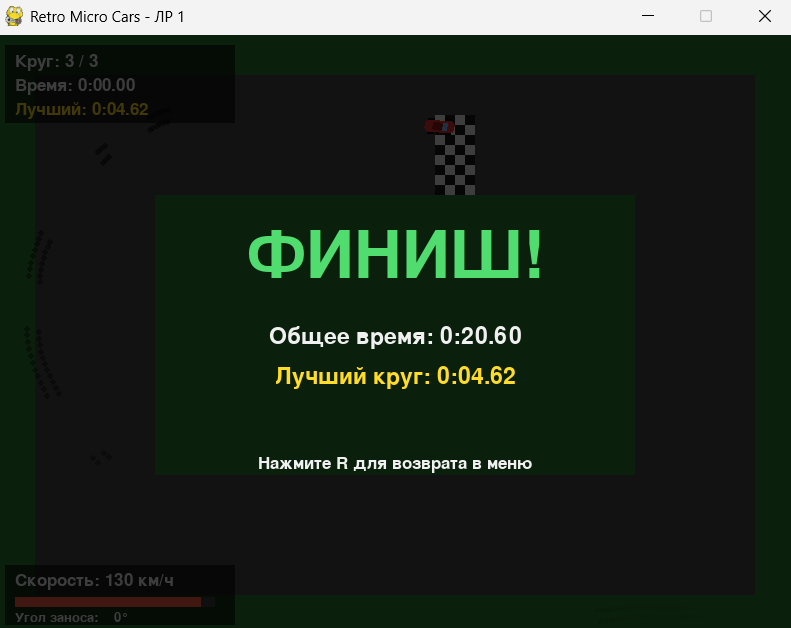
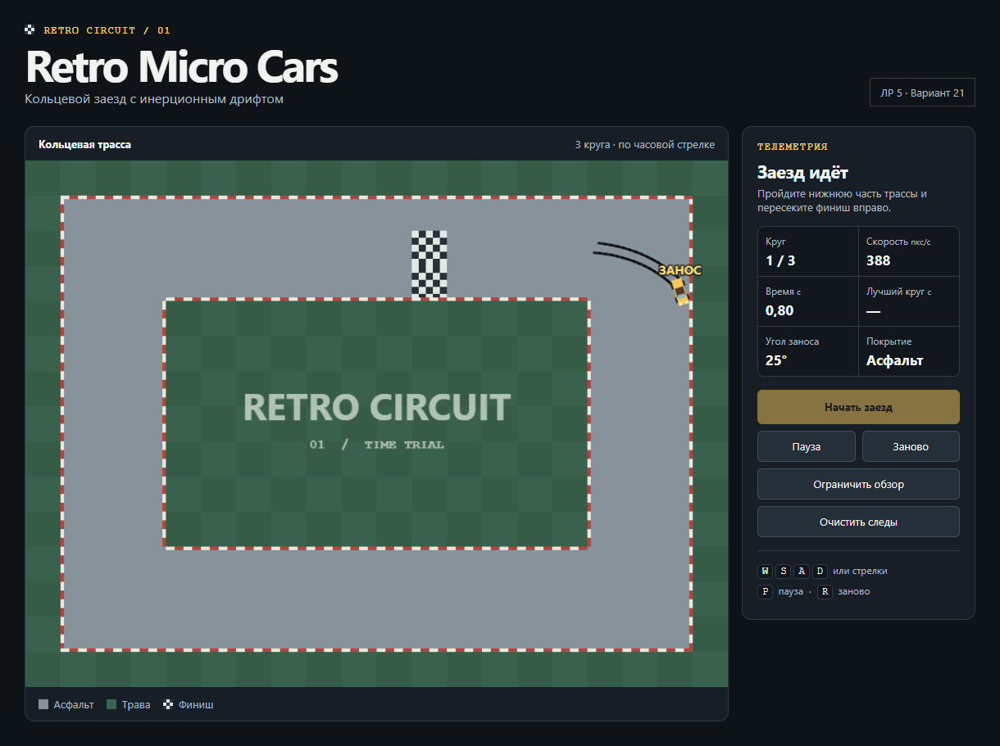

# Retro Micro Cars
## «Гонки с видом сверху: Инерционный дрифт» — вариант 21

Retro Micro Cars — гоночная аркада с видом сверху и физикой сцепления колёс с дорогой.

Игрок проходит три круга по кольцевой трассе. При резком повороте машина скользит по инерции и оставляет следы протектора. Выезд на траву снижает сцепление и скорость. После финиша результат сохраняется в таблицу рекордов.

Telegram-бот «Гоночный инженер» анализирует выгрузки игры: показывает рейтинги по времени круга и секторам, статистику пилотов и уведомляет о новых рекордах.

Автор: Лиховидов К.А.

| Лабораторная работа | Реализация |
|--------------------|------------|
| ЛР 1 | Окно Pygame, управление машиной, физика дрифта, игровой интерфейс |
| ЛР 2 | Трасса в текстовом файле, влияние покрытия, JSON рекордов, лог событий |
| ЛР 3 | Telegram-бот, приём выгрузок, аналитика, JSON-сессии, FSM и уведомления |
| [ЛР 4](#лр-4-ядро-на-javascript) | Физика автомобиля, трасса и цикл заезда на JavaScript с самопроверкой |
| [ЛР 5](#лр-5-браузерный-виджет) | Игра в браузере на Canvas, затухающие следы шин и вызываемые сценарии |
| [ЛР 6](#лр-6-панель-управления-трассами) | Каталог трасс с CRUD, поиском, фильтром и сохранением в localStorage |

---

## Стек технологий

- **Node.js 18+** для ядра ЛР 4
- **Python 3.14.7**
- **pygame-ce 2.5.8** — окно, обработка ввода и отрисовка; используется через `import pygame`
- **aiogram 3.31.0** — Telegram Bot API, обработчики событий и FSM
- **python-dotenv 1.2.1** — загрузка токена из `.env`

---

## Структура проекта

```text
Retro-Micro-Cars/
├── README.md
├── requirements.txt          # Основные зависимости
├── requirements-lock.txt     # Полный список закреплённых версий
├── .gitignore
├── py_retro_cars/
│   ├── main.py               # Точка входа в игру
│   ├── __init__.py
│   ├── constants.py          # Общие параметры игры
│   ├── game.py               # Игровой цикл, круги и замер секторов
│   ├── car.py                # Машина, управление и спрайт
│   ├── physics.py            # Скорость, поворот и боковое скольжение
│   ├── track.py              # Игровые зоны и отрисовка трассы
│   ├── timing.py             # Геометрия дорожного кольца для хронометража
│   ├── skid_marks.py         # Следы протектора
│   ├── ui.py                 # Меню, HUD и экраны завершения
│   ├── data_io.py            # Чтение карты, запись рекордов и логирование
│   ├── track.txt             # Карта трассы
│   └── screenshots/          # Скриншоты игры
├── py_bot/
│   ├── bot.py                # Точка входа, команды, загрузки и уведомления
│   ├── config.py             # Пути к данным проекта
│   ├── session.py            # Чтение и атомарная запись JSON-сессий
│   ├── storage.py            # JSON-хранилище FSM aiogram
│   ├── analytics.py          # Валидация, рейтинг и статистика
│   ├── keyboards.py          # Инлайн-клавиатуры
│   ├── requirements.txt      # Зависимости бота
│   ├── .env.example          # Образец настройки токена
│   └── sample_data/          # Примеры выгрузок
├── retro_cars_js/            # Ядро ЛР 4 и самопроверка
├── retro_cars_widget/        # Браузерная игра ЛР 5
├── retro_cars_crud/          # Панель трасс ЛР 6
└── tests/
    └── test_lab3.py           # Проверки аналитики, бота и экспорта игры
```

### Назначение модулей

| Модуль | Назначение |
|--------|------------|
| `constants.py` | Размеры окна, цвета, параметры движения, покрытия и гонки |
| `physics.py` | Расчёт скорости, направления движения и угла заноса |
| `car.py` | Состояние машины, управление, определение покрытия и отрисовка |
| `track.py` | Определение типа плитки по координатам, финишная зона и фон трассы |
| `timing.py` | Построение средней линии прямоугольного дорожного кольца |
| `game.py` | Игровой цикл, состояния экранов, подсчёт кругов и замер секторов |
| `data_io.py` | Загрузка `track.txt`, сохранение `records.json`, запись `game_flight.log` |
| `ui.py`, `skid_marks.py` | Интерфейс и постепенно исчезающие следы дрифта |
| `bot.py`, `keyboards.py` | Команды Telegram, сообщения-экраны и инлайн-кнопки |
| `session.py`, `storage.py` | Сессии пользователей и восстановление состояния FSM из JSON |
| `analytics.py` | Проверка выгрузок, объединение результатов, рейтинг круга и секторов |

---

## Запуск игры

Команды выполняются из корня проекта:

```powershell
python -m pip install --only-binary=:all: -r requirements.txt
python py_retro_cars/main.py
```

В PyCharm точка входа — `py_retro_cars/main.py`, интерпретатор — окружение проекта на Python 3.14.7.

---

## Управление

| Клавиша | Действие |
|---------|----------|
| `W` / `↑` | Разгон |
| `S` / `↓` | Торможение, затем задний ход |
| `A` / `←` | Поворот влево |
| `D` / `→` | Поворот вправо |
| `R` | Возврат в меню во время заезда или после финиша |
| `Enter` | Подтверждение имени и сохранение результата |
| `Backspace` | Удаление символа при вводе имени |
| Закрыть окно | Выход из игры |

---

## Механики игры

### Движение и дрифт

Машина хранит координаты `x`, `y`, угол кузова `theta`, скорость `speed` и фактический вектор движения `vx`, `vy`. Клавиши газа и тормоза изменяют скорость, повороты меняют направление кузова.

Вектор движения постепенно приближается к направлению кузова:

```python
target_x = cos(theta) * speed
target_y = sin(theta) * speed
vx += (target_x - vx) * K
vy += (target_y - vy) * K
```

Коэффициент сцепления `K` определяет скорость этого изменения. При резком повороте фактическое движение отстаёт от кузова: возникает занос. При угле скольжения больше 0,3 радиана и достаточной скорости отображается индикатор заноса; на асфальте появляются следы задних колёс.

### Покрытие трассы

| Символ | Покрытие | Параметры |
|--------|----------|-----------|
| `#` | Асфальт | Сцепление `K = 0.1`, максимальная скорость `7.0` |
| `.` | Трава | Сцепление `K = 0.04`, максимальная скорость `3.0` |
| `F` | Финиш | Дорожная зона с шахматной разметкой |

Трава проезжаема. Превышение допустимой скорости постепенно гасится, следы протектора на траве не создаются. Границы окна ограничивают перемещение машины.

### Круги и секторы

Хронометраж начинается при первом пересечении финиша вправо. Затем нужно завершить три круга. Для зачёта круга машина должна пройти нижнюю контрольную область и снова пересечь финиш вправо.

Секторы разделяются двумя горизонтальными воротами на середине высоты кольца: справа машина пересекает границу сверху вниз, слева — снизу вверх. S1 проходит от финиша до правых ворот, S2 — через нижнюю часть трассы до левых ворот, S3 — до финиша. Пересечение учитывается и на траве; время внутри кадра определяется интерполяцией.

В рекорд записываются три длительности лучшего круга. Если полный замер отсутствует, поле `sectors` имеет значение `null`.

---

## Интерфейс

| Экран | Содержимое |
|-------|------------|
| Стартовый | Название игры, управление и пять лучших кругов |
| Игровой | Трасса, машина, следы дрифта, круг, время, скорость, угол заноса и индикатор травы |
| Ввод имени | Итоги заезда и поле имени длиной до 12 символов |
| Завершение | Общее время, лучший круг, таблица рекордов и результат сохранения |

Пустое имя при сохранении заменяется на «Игрок».

---

## Конфигурация

Основные параметры находятся в `py_retro_cars/constants.py`:

```python
GRIP_K = 0.1
MAX_SPEED = 7.0
TURN_RATE = 0.055
DRIFT_ANGLE_THRESHOLD = 0.3
GRASS_GRIP_K = 0.04
GRASS_MAX_SPEED = 3.0
TOTAL_LAPS = 3
```

Окно игры — 800×600 пикселей, размер плитки — 40×40 пикселей, частота обновления — 60 кадров в секунду. Геометрия трассы задаётся файлом `track.txt`.

---

## Файлы данных

### track.txt

Карта представляет собой 15 строк по 20 символов:

```text
....................
.##################.
.##########F#######.
.##########F#######.
.###............###.
.###............###.
.###............###.
.###............###.
.###............###.
.###............###.
.###............###.
.##################.
.##################.
.##################.
....................
```

Игра проверяет размеры карты, допустимые символы, наличие финиша и дорожное покрытие стартовой позиции. При отсутствии или повреждении файла используется запасная карта из `constants.py`, а ошибка записывается в лог.

### records.json

После финиша игра сохраняет имя, лучший круг, время заезда, секторные длительности, версию секторных границ, идентификатор трассы и дату:

```json
{
  "records": [
    {
      "name": "Пилот",
      "best_lap": 28.5,
      "total_time": 90.0,
      "sectors": [8.5, 9.5, 10.5],
      "sector_version": 2,
      "track_id": "97a9f2635104f31e586d4bb8d10d0794253bcbf63a5dbfa6254e845568fb1094",
      "date": "2026-11-01 20:00:00"
    }
  ]
}
```

JSON сохраняет вложенный массив секторов и передаётся боту без преобразования. Записи сортируются по `best_lap`: в файле остаются 50 лучших результатов, в игре показываются первые пять. Файл создаётся при первом сохранении. Запись выполняется через временный файл и `os.replace`.

Старые записи без секторных данных доступны в рейтинге кругов. Для сравнения S1–S3 используются полные замеры версии 2; отсутствующие времена из общего времени круга не восстанавливаются.

### game_flight.log

Лог игровых событий с датой, временем и уровнем сообщения:

```text
2026-11-01 20:00:00 | INFO | Игра запущена
2026-11-01 20:00:05 | INFO | Старт заезда
2026-11-01 20:00:06 | INFO | Хронометраж начат на финишной линии
2026-11-01 20:00:12 | INFO | Круг 1 завершён за 5.12 с
```

Записываются запуск и завершение игры, начало заезда, заносы, смена покрытия, секторные отметки, завершение кругов, сохранение рекордов и ошибки чтения файлов.

---

## Скриншоты

### Стартовый экран



Название игры, управление и таблица лучших кругов.

### Игровой процесс



Машина на трассе и показатели текущего заезда.

### Дрифт



Боковое скольжение машины и следы протектора.

### Ввод имени



Сохранение результата после завершения трёх кругов.

### Итоги заезда



Общее время, лучший круг и таблица рекордов.

---

## Зависимости

Проверенная конфигурация — Python 3.14.7, pygame-ce 2.5.8, aiogram 3.31.0 и python-dotenv 1.2.1. Основные пакеты перечислены в `requirements.txt`, полное окружение — в `requirements-lock.txt`.

```powershell
python -c "import pygame, aiogram; print(pygame.version.ver); print(aiogram.__version__)"
```

---

## Telegram-бот «Гоночный инженер»

Бот работает с данными Pygame-игры: картой `track.txt` и таблицей `records.json`. Управление осуществляется командами и инлайн-кнопками. Игровая логика выполняется в приложении Pygame.

### Возможности

| Команда | Назначение |
|---------|------------|
| `/start` | Главное меню |
| `/top` | Десять лучших пилотов по времени круга |
| `/top s1`, `/top s2`, `/top s3` | Рейтинг выбранного сектора |
| `/upload` | Приём файла трека или JSON рекордов |
| `/stats` | Статистика пилотов текущей трассы |
| `/stats Имя` | Статистика пилота с указанным именем |
| `/watch` | Включение или выключение уведомлений о рекордах |
| `/help` | Справка |

Кнопка «Импорт из игры на этом ПК» загружает локальный `py_retro_cars/records.json`. Для передачи файлов через Telegram используется `/upload`: сначала выбирается трек, затем отправляется его JSON. Загрузка карты в бот не изменяет карту игры.

### Проверка выгрузок и аналитика

- Принимаются документы `.txt` и `.json` в UTF-8 размером до 1 МБ.
- Для трека проверяются размеры 15×20, символы `#`, `.`, `F`, наличие и связность финиша, связность дороги и стартовая позиция.
- Для рекорда проверяются имя, положительные конечные времена, соотношение времени круга и заезда, три секторные длительности и их сумма.
- Валидные записи частично повреждённой выгрузки принимаются; ошибки возвращаются пользователю. Повторная загрузка одинаковых записей не создаёт дубликаты.
- Идентификатор трассы вычисляется как SHA-256 её нормализованного содержимого. Рейтинги разных трасс хранятся отдельно.
- Для каждого пилота выбирается минимальное время круга или сектора. Статистика отражает только загруженные результаты.
- Подписчики получают уведомления об улучшении общего рекорда круга или сектора при загрузке либо локальном импорте JSON.

### Сессии и FSM

Состояние пользователя хранится в JSON по Telegram `user_id`. FSM содержит состояния `MENU`, `UPLOAD` и `RESULT`; `JsonStorage` восстанавливает их после перезапуска. Экраны обновляются через `edit_message_text`; удалённое сообщение заменяется новым, неизменившееся не дублируется.

Пример сессии:

```json
{
  "state": "Engineer:UPLOAD",
  "data": {},
  "screen_message_id": 123,
  "screen_chat_id": 123456789,
  "track_id": "97a9f2635104f31e586d4bb8d10d0794253bcbf63a5dbfa6254e845568fb1094",
  "watch_track": "97a9f2635104f31e586d4bb8d10d0794253bcbf63a5dbfa6254e845568fb1094"
}
```

### Данные бота

```text
py_bot/data/
├── sessions/<user_id>.json        # Состояние, экран, трасса и подписка
├── tracks/<track_id>.json         # Проверенные карты
├── leaderboards/<track_id>.json   # Общий рейтинг выбранной трассы
└── bot_flight.log                 # События и ошибки с временными метками
```

Сессии пользователей изолированы; рейтинг одной трассы общий. JSON записывается атомарно, обращения одного пользователя и обновление общей базы защищены блокировками. Файлы `.env`, окружение и рабочие данные исключены из Git.

### Запуск

Бота необходимо создать через [@BotFather](https://t.me/BotFather). Токен задаётся в `py_bot/.env` по образцу `.env.example`:

```dotenv
BOT_TOKEN=ваш_токен
```

После установки общих зависимостей бот запускается из корня проекта:

```powershell
python py_bot/bot.py
```

В PyCharm точка входа — `py_bot/bot.py`. Для одного токена запускается один процесс поллинга.

---

## ЛР 4. Ядро на JavaScript

Класс `Car` переносит модель автомобиля из ЛР 1–2 в ES-модули. `Race` принимает команды управления, обновляет машину и проверяет условия зачёта круга. Ядро запускается в Node.js 18+ без дополнительных пакетов.

### Запуск самопроверки

Из корня репозитория:

```powershell
node retro_cars_js/selftest.js
```

Результат на Node.js 24.19.0 — **32 из 32 проверок пройдены**. Самопроверка охватывает геометрию, валидацию трассы, разгон и торможение, пороги заноса, поведение на траве и у границ, защиту от повторного зачёта финиша и полный заезд на три круга. Заезд в самопроверке выполняется командами газа и руля.

### Модули ядра

| Файл в `retro_cars_js/` | Назначение |
|---|---|
| `package.json` | Режим ES-модулей через `"type": "module"` |
| `js/car.js` | Состояние и физический шаг машины, координаты и углы кузова |
| `js/physics.js` | Разгон, торможение, угловая скорость, сцепление и порог заноса |
| `js/rect.js` | Прямоугольник, пересечение, попадание точки и сдвиг копии |
| `js/track.js`, `track.json` | Карта из ЛР 2, проверка конфигурации, поиск покрытия и финиша |
| `js/race.js` | Цикл заезда, хронометраж, круги и события |
| `js/constants.js`, `selftest.js` | Параметры физики и запуск самопроверки |

### Расчёт движения

Физика обновляется с фиксированным шагом `dt = 1/60 с`. Как в Python, целевая скорость вдоль кузова `speed` и компоненты фактической скорости `vx`, `vy` хранятся в пикселях за кадр. Газ прибавляет `0.12` за шаг, тормоз при движении вперёд вычитает `0.25`, а без ввода сопротивление качению приближает скорость к нулю на `0.04` за шаг.

```text
ω = steer · TURN_RATE · clamp(speed / MIN_STEER_SPEED, −1, 1) / dt
θ ← normalize(θ + ω · dt)

f = (cos θ, sin θ)       # вдоль кузова
n = (−sin θ, cos θ)      # поперёк кузова
v∥ = v · f
v⊥ = v · n
Δv = K · (speed − v∥) · f − K · v⊥ · n

a = Δv / dt²            # ускорение от сцепления в пикселях/с²
v ← v + Δv
(x, y) ← (x, y) + v
```

Продольная составляющая корректирует скорость в направлении кузова. Поперечная действует против бокового скольжения. При неизменном направлении за кадр остаётся доля `1 − K` боковой скорости. На траве `K = 0.04` вместо `0.1`, поэтому боковая скорость затухает медленнее. Предел движения вперёд на траве снижается с 7 до 3 пикселей за кадр. Превышение гасится постепенно, как в Python-версии.

Занос регистрируется при `hypot(vx, vy) ≥ 2` и `abs(normalize(atan2(vy, vx) − θ)) > 0.3` радиана. В заносе положительная целевая скорость уменьшается на 1,2% за кадр. При достижении границы поля гасится только компонента движения наружу. Движение вдоль границы остаётся возможным.

### Состояния заезда

| Состояние | Условие перехода |
|---|---|
| `ready` | `start()` переводит заезд в `running` |
| `running` | Первое пересечение финиша вправо запускает отсчёт. Следующие пересечения засчитываются после нижней контрольной зоны |
| `finished` | Третий зачтённый круг останавливает обновление. `reset()` возвращает заезд в `ready` |

Время круга рассчитывается по числу кадров. Журнал `events` отдельно хранит старт, начало отсчёта, смену покрытия, вход и выход из заноса, круги и итог заезда. При чтении `track.json` проверяются размер 15×20, символы `#`, `.`, `F`, наличие финиша и покрытие в стартовой точке.

---

## ЛР 5. Браузерный виджет

Виджет на HTML5 Canvas подключает `Race`, `Track` и параметры физики из ЛР 4 через ES-модули. На трассе появляются чёрные линии от задних колёс при заносе. Их непрозрачность линейно уменьшается от 0,88 до нуля за 240 шагов симуляции, то есть за 4 секунды. Над автомобилем в заносе появляется анимированный индикатор.



### Запуск игры

Из корня репозитория запустите локальный сервер.

```powershell
python -m http.server 8000 --bind 127.0.0.1
```

Откройте [игру в браузере](http://127.0.0.1:8000/retro_cars_widget/) и нажмите **«Начать заезд»**. Сервер запускается из корня, чтобы браузер мог загрузить и виджет, и ядро из соседней папки `retro_cars_js`.

| Клавиши | Действие |
|---|---|
| `W` / `↑` | Газ |
| `S` / `↓` | Тормоз, затем задний ход |
| `A` / `←`, `D` / `→` | Поворот влево и вправо |
| `P` | Пауза или продолжение |
| `R` | Новый заезд |

Первое пересечение клетчатой линии вправо запускает хронометраж. Для зачёта круга нужно проехать нижнюю часть трассы и снова пересечь линию вправо. После трёх кругов экран показывает результат.

### Вызываемые сценарии

Кнопки с атрибутом `data-scenario` вызывают те же функции, что доступны в консоли браузера через `RetroMicroCars.scenarios`.

| Кнопка | Вызов из консоли | Действие |
|---|---|---|
| Начать заезд / Новый заезд | `RetroMicroCars.scenarios.start()` | Начать заезд с готовности или после финиша |
| Пауза / Продолжить | `RetroMicroCars.scenarios.pause()` | Приостановить или продолжить симуляцию |
| Заново | `RetroMicroCars.scenarios.restart()` | Сбросить круги, время и следы, затем начать заезд |
| Ограничить обзор / Вернуть полный обзор | `RetroMicroCars.scenarios.toggleVisibility()` | Переключить полный обзор и круг видимости радиусом 270 пикселей |
| Очистить следы | `RetroMicroCars.scenarios.clearSkidMarks()` | Удалить текущие линии. При следующем движении в заносе они появляются снова |

### Устройство виджета

| Файл в `retro_cars_widget/` | Назначение |
|---|---|
| `index.html`, `css/style.css` | Холст, панель показателей и кнопки |
| `js/widget.js` | Загрузка трассы, игровой цикл и обновление показателей через `textContent` |
| `js/input.js` | Флаги нажатых клавиш, которые опрашиваются на каждом шаге |
| `js/renderer.js` | Отрисовка трассы, машины, следов и индикатора заноса |
| `js/skid-marks.js` | Координаты задних колёс и срок жизни сегментов |
| `js/scenarios.js` | Реестр функций для кнопок и консоли |

`requestAnimationFrame` задаёт частоту отрисовки. Накопитель времени выделяет из каждого интервала шаги по `1000 / 60` мс для физики. Интервал между кадрами ограничен 100 мс. При смене видимости вкладки накопитель и флаги клавиш сбрасываются.

В Chromium проверены управление, полный заезд на три круга, финиш, пауза и рестарт. При имитации отрисовки в 30 и 120 Гц модель выполнила около 60 шагов за секунду. Появление и затухание следов проверены по пикселям Canvas, а удаление проверено после 240 шагов. Самопроверка ядра ЛР 4 прошла 32 из 32 проверок.

---

## ЛР 6. Панель управления трассами

Страница `retro_cars_crud/index.html` управляет каталогом гоночных трасс варианта 21. Трассу можно добавить, найти в таблице, отредактировать прямо в строке и удалить после подтверждения.

Нажмите **Играть** в строке трассы, чтобы начать заезд. Игра строит замкнутый контур по координатам углов и размещает на нём заданное число чекпоинтов. Кнопка **К каталогу трасс** возвращает к списку, где можно выбрать другую трассу. Для заезда на исходной карте выберите **Стандартная трасса**.

### Запуск

В PyCharm откройте весь проект `Retro-Micro-Cars` и выберите **Open in Browser** для `retro_cars_crud/index.html`. Вне IDE запустите из корня проекта локальный сервер.

```powershell
python -m http.server 8000 --bind 127.0.0.1
```

Откройте [панель трасс](http://127.0.0.1:8000/retro_cars_crud/). Для CRUD достаточно браузера с поддержкой ES-модулей и `crypto.randomUUID()`.

### Поля записи

| Поле | Формат |
|---|---|
| `id` | UUID v4, назначается при создании и сохраняется при редактировании |
| `name` | Название длиной 1–80 символов после удаления пробелов с краёв |
| `length` | Длина в метрах от 0,01 до 100 000, допускается дробная часть |
| `checkpoints` | Целое количество чекпоинтов от 0 до 100 |
| `corners` | JSON-массив из 3–100 пар чисел `[x, y]`, минимум три разные точки. Для поля 800 × 600 допустимы `0 ≤ x ≤ 800` и `0 ≤ y ≤ 600` |

Пример координат углов прямоугольной трассы.

```json
[[80, 80], [720, 80], [720, 520], [80, 520]]
```

### Хранение и интерфейс

| Файл в `retro_cars_crud/` | Назначение |
|---|---|
| `index.html`, `css/style.css` | Форма добавления, фильтры, таблица и оформление |
| `js/tracks.js` | Валидация полей, чтение и запись каталога |
| `js/crud.js` | CRUD, поиск, фильтр по максимальной длине, рендер и делегирование действий на `tbody` |

После каждой успешной операции массив сохраняется в JSON под ключом `retro_micro_cars_tracks` в `localStorage`. Каталог привязан к адресу страницы, поэтому запуск через PyCharm и запуск через Python на разных портах используют разные хранилища. Если JSON повреждён или сохранение завершилось ошибкой, панель показывает сообщение и оставляет сохранённые данные на месте.

Поля проверяются при добавлении и при сохранении правки. Ошибки показаны рядом с полями. Пользовательский текст проходит через `escapeHtml` перед вставкой в HTML таблицы и редактора.

### Проверка

1. Добавьте «Северное кольцо» длиной 1200 м с четырьмя чекпоинтами и координатами из примера. Попробуйте сохранить запись с отрицательной длиной или неверным JSON и проверьте сообщения у полей.
2. Введите «север» в поиск и задайте максимальную длину 1000 м. Сбросьте фильтр, чтобы строка снова появилась.
3. Нажмите **«Изменить»** и сохраните новую длину. Перезагрузите страницу и проверьте значение. Повторите правку с кнопкой **«Отмена»**.
4. Нажмите **«Удалить»**, подтвердите действие и перезагрузите страницу. Актуальный массив можно проверить в DevTools на вкладке **Application → Local Storage**.

В Chromium проверены все операции CRUD, сохранение после перезагрузки, комбинированная фильтрация, валидация, экранирование HTML и обработка ошибок хранилища.
