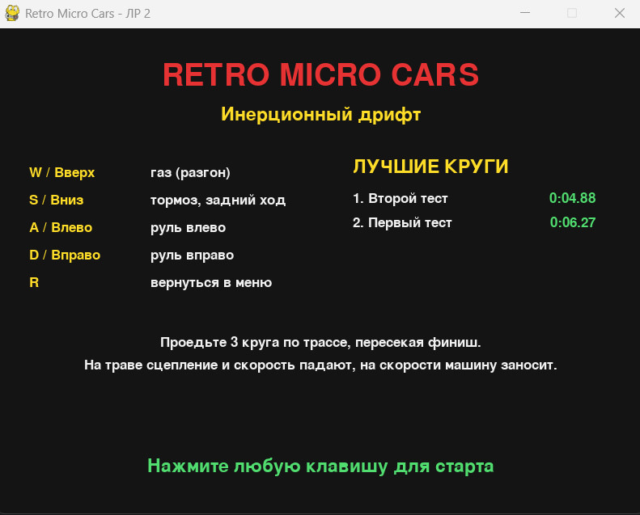
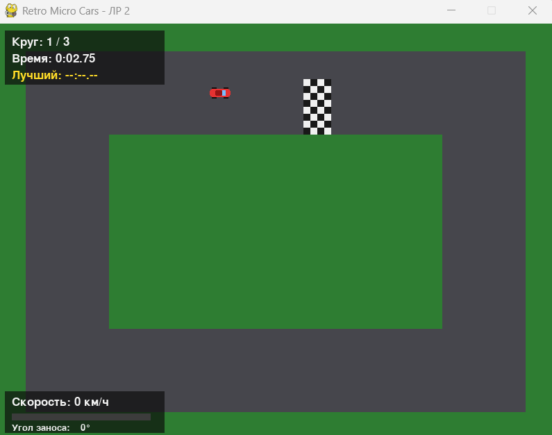
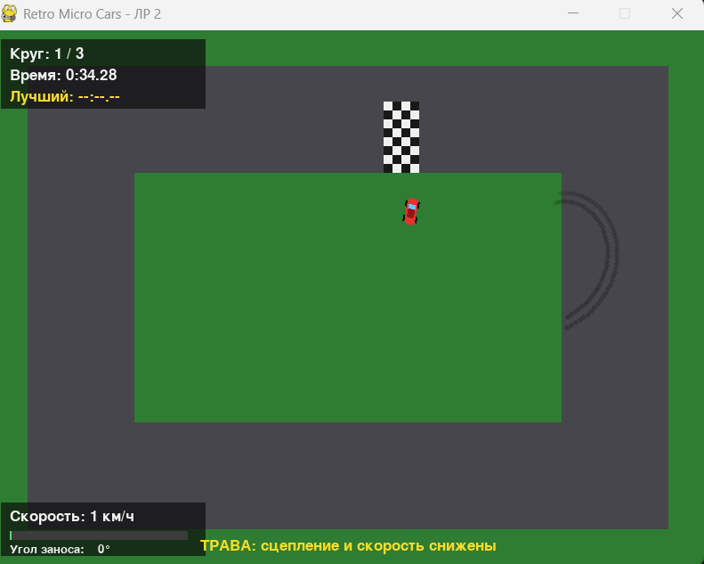
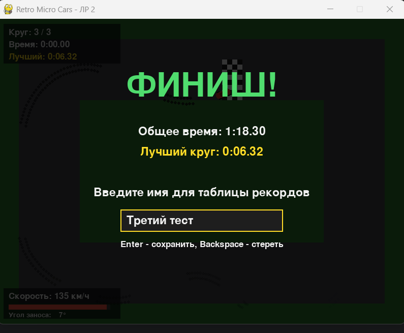
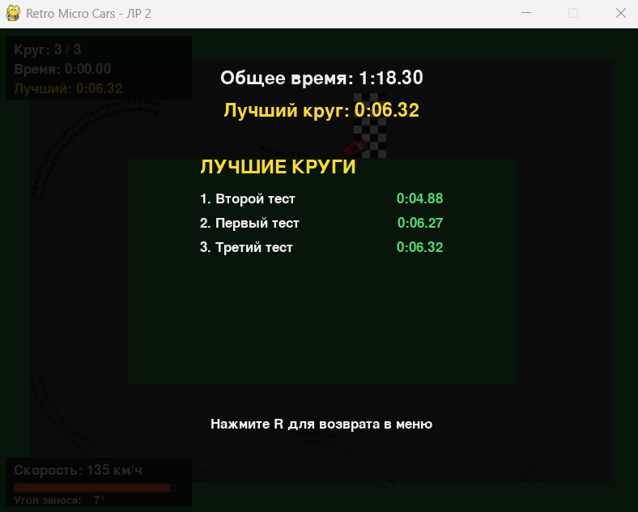

# Retro Micro Cars
## «Гонки с видом сверху: Инерционный дрифт» (Вариант 21)

Retro Micro Cars — 2D гоночная аркада с видом сверху и физикой сцепления колёс с дорогой.

Игрок управляет машиной на кольцевой трассе. При резком повороте на скорости машину заносит по инерции: вектор фактического движения не успевает развернуться за кузовом, а на асфальте остаются следы протектора. Нужно проехать 3 круга.

Автор: Лиховидов К.А.

- ЛР 1 «Алгоритмизация на языке Python»: физика дрифта, трасса, интерфейс.
- ЛР 2 «Управление файлами и представление данных»: карта трассы в `track.txt`, рекорды в JSON, лог, влияние травы.

---

## Стек технологий

- **Python 3.12+**
- **Pygame 2.6.1** — окно, ввод, отрисовка

---

## Структура проекта

```
retro_micro_cars/
├── .gitignore
├── requirements.txt
└── py_retro_cars/
    ├── main.py          # Точка входа в приложение
    ├── __init__.py      # Документация пакета
    ├── constants.py     # Все константы: окно, физика, трава, цвета, запасная трасса, тексты
    ├── physics.py       # Математика дрифта (без Pygame)
    ├── track.py         # Трасса: тайлы, проверка покрытия, отрисовка
    ├── data_io.py       # Файлы: загрузка track.txt, records.json, логирование
    ├── track.txt        # Карта трассы (# асфальт, . трава, F финиш)
    ├── records.json     # Таблица рекордов (создаётся автоматически)
    ├── game_flight.log  # Лог событий с timestamp (создаётся автоматически)
    ├── car.py           # Класс машины: состояние, управление, спрайт
    ├── skid_marks.py    # Следы протектора с постепенным исчезновением
    ├── ui.py            # Интерфейс: меню, HUD, экран финиша
    ├── game.py          # Игровой цикл, конечный автомат, подсчёт кругов
    ├── README.md
    └── screenshots/     # Скриншоты для этого README
```

### Назначение модулей

| Модуль | Назначение |
|--------|-----------|
| `constants.py` | Размеры окна, параметры физики (`GRIP_K`, `MAX_SPEED`, …), параметры травы, цвета, запасная трасса, тексты |
| `physics.py` | Чистые функции: скорость, поворот, вектор движения, угол заноса |
| `track.py` | Класс `Track`: `tile_at`, `is_grass`, `on_finish`, отрисовка |
| `data_io.py` | `load_track`, `validate_track`, `load_records`, `save_record`, `setup_logging` |
| `car.py` | Класс `Car`: координаты, `theta`, `speed`, `(vx, vy)`, `update`, `draw` |
| `skid_marks.py` | Класс `SkidMarks`: добавление, старение и отрисовка следов |
| `ui.py` | `draw_menu`, `draw_hud`, `draw_name_input`, `draw_game_over`, `draw_records` |
| `game.py` | Класс `Game` и функция `main()`: цикл, состояния, круги, логирование событий |

---

## Запуск игры

```bash
pip install -r requirements.txt
cd py_retro_cars/
python3 main.py
```

---

## Управление

| Клавиша | Действие |
|---------|----------|
| `W` / `↑` | Газ (разгон) |
| `S` / `↓` | Тормоз, затем задний ход |
| `A` / `←` | Поворот кузова влево |
| `D` / `→` | Поворот кузова вправо |
| `R` | Возврат в меню |
| `Enter` / `Backspace` | Сохранить / стереть символ при вводе имени |
| Закрыть окно | Выход |

---

## Механики игры

### 1. Состояние машины

| Параметр | Описание |
|----------|----------|
| `x`, `y` | Координаты центра машины |
| `theta` | Угол кузова в радианах (0 — вправо) |
| `speed` | Линейная скорость вдоль кузова |
| `vx`, `vy` | Фактический вектор движения |

### 2. Алгоритм дрифта

Каждый кадр вектор движения плавно приближается к «идеальному» вектору, направленному по кузову:

```python
target_x = cos(theta) * speed
target_y = sin(theta) * speed
vx += (target_x - vx) * K
vy += (target_y - vy) * K
```

`K` — коэффициент сцепления (`GRIP_K = 0.1`). Чем он меньше, тем дольше машина «помнит» прежнее направление и тем сильнее заносит. При `K = 1` машина едет строго по кузову.

**Занос** определяется по углу между направлением движения и кузовом: если угол больше `DRIFT_ANGLE_THRESHOLD` (0.3 рад ≈ 17°) и скорость не меньше `DRIFT_MIN_SPEED`, машина в заносе. В заносе:

- на экране появляется надпись «ЗАНОС!»;
- задние колёса оставляют следы протектора, которые бледнеют за 240 кадров;
- машина теряет 1.2 % скорости за кадр.

### 3. Управление скоростью и рулём

- Скорость растёт на `ACCELERATION` за кадр при `W`, падает на `BRAKE_POWER` при `S`. После остановки `S` включает задний ход.
- **Ограничения скорости**: `MAX_SPEED = 7.0` вперёд, `MAX_REVERSE_SPEED = -2.5` назад.
- Без газа машина катится и замедляется на `ROLLING_FRICTION`.
- Руль зависит от скорости: на месте машина не поворачивается, при заднем ходе руль инвертируется.

### 4. Трасса, трава и границы

Карта читается из `track.txt` (15 строк × 20 символов) и преобразуется в игровые зоны:

| Символ | Тип | Описание |
|--------|-----|----------|
| `#` | Асфальт | `K = 0.1`, `MAX_SPEED = 7.0` |
| `.` | Трава | Проезжая, но сцепление и скорость **принудительно снижены**: `K = 0.04`, предел скорости `3.0` |
| `F` | Финиш | Шахматная линия, по ней считаются круги |

Покрытие определяется по тайлу под центром машины. На траве колёса почти не держат дорогу, а превышение предела скорости быстро гасится. Следы протектора остаются только на асфальте. Машина не может выехать за границы окна.

### 5. Круги и финиш

Круг засчитывается, если машина проехала контрольную точку на нижней части трассы и пересекла финиш вправо. Это защищает от накрутки кругов поездкой туда-сюда по линии. После `TOTAL_LAPS = 3` кругов гонка завершается.

---

## Интерфейс

### Стартовый экран
- Название игры и подзаголовок
- Таблица управления
- Таблица рекордов (топ-5)
- Подсказка «Нажмите любую клавишу для старта»

### Игровой экран
- Трасса, машина, следы протектора
- Круг, время круга и лучший круг
- Спидометр со шкалой и угол заноса в градусах
- Надпись «ЗАНОС!» при заносе и подсказка при выезде на траву

### Ввод имени
- После третьего круга: итоги заезда и поле ввода имени (до 12 символов)
- Enter сохраняет результат; пустое имя заменяется на «Игрок»

### Экран завершения
- Общее время, лучший круг и таблица «Лучшие круги» (топ-5)
- Сообщение об ошибке, если результат не удалось записать
- Подсказка «Нажмите R для возврата в меню»

---

## Конфигурация

Основные параметры лежат в `constants.py`:

```python
GRIP_K = 0.1                  # коэффициент сцепления
MAX_SPEED = 7.0               # максимальная скорость
TURN_RATE = 0.055             # поворот кузова за кадр
DRIFT_ANGLE_THRESHOLD = 0.3   # порог заноса, рад
GRASS_GRIP_K = 0.04           # сцепление на траве
GRASS_MAX_SPEED = 3.0         # предел скорости на траве
TOTAL_LAPS = 3                # число кругов
```

---

## Файлы данных

### track.txt

Карта трассы, загружается при старте. Один символ — одна плитка 40×40 пикселей:

```
....................
.##################.
.##########F#######.
.##########F#######.
.###............###.
...
```

Файл проверяется (`validate_track`): ровно 15 строк по 20 символов, допустимы только `#`, `.`, `F`, есть хотя бы одна `F`, стартовая позиция машины не на траве. Если файл отсутствует, не читается или неверен, игра сообщает об ошибке в консоль и лог и запускается с запасной трассой из `constants.py` (`DEFAULT_TRACK_LAYOUT`).

### records.json

Таблица рекордов лучших кругов. JSON выбран, потому что хранит вложенную структуру и легко читается человеком:

```json
{
  "records": [
    {"name": "Костя", "best_lap": 7.58, "total_time": 23.78, "date": "2026-10-10 21:45:20"},
    {"name": "Аня", "best_lap": 12.35, "total_time": 40.1, "date": "2026-10-10 21:50:02"}
  ]
}
```

- Записи сортируются по `best_lap`, в файле хранится до 50, на экране показываются 5 лучших.
- Файл создаётся при первом сохранении.
- Запись атомарная: данные пишутся во временный `records.tmp`, затем он заменяет оригинал (`os.replace`). Сбой посреди записи не портит старый файл.
- Повреждённый файл (ошибка JSON, неверная структура) не роняет игру: таблица начинается заново, некорректные записи пропускаются.

### game_flight.log

Лог событий с временными метками (модуль `logging`):

```
2026-10-10 21:45:20 | INFO | Игра запущена
2026-10-10 21:45:20 | INFO | Трасса загружена из track.txt
2026-10-10 21:45:21 | INFO | Старт заезда
2026-10-10 21:45:23 | INFO | Занос: скорость 4.2, угол 25°
2026-10-10 21:45:24 | INFO | Машина покинула трассу
2026-10-10 21:45:28 | INFO | Круг 1 завершён за 8.60 с
2026-10-10 21:45:45 | INFO | Финиш: общее время 23.78 с, лучший круг 7.58 с
2026-10-10 21:45:50 | INFO | Рекорд сохранён: Костя, лучший круг 7.58 с
```

Записываются: запуск и закрытие игры, старт и прерывание заезда, занос (дольше 15 кадров), выезд на траву и возврат, завершённые круги, финиш, сохранение рекорда, а также все ошибки чтения файлов (уровень WARNING).

---

## Скриншоты

Скриншоты лежат в папке `screenshots/`.

### Стартовый экран



### Заезд по трассе



### Занос со следами протектора



### Ввод имени после финиша



### Итоги и таблица рекордов



---

## Зависимости

Нужны Python 3.12+ и Pygame:

```bash
python3 -c "import pygame; print(pygame.__version__)"
pip install pygame
```
